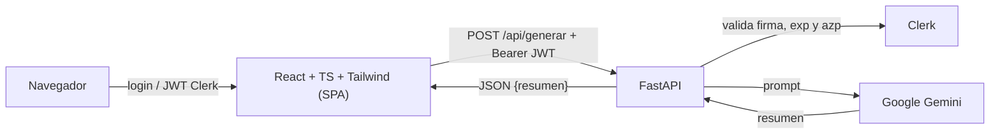

# Práctica UD1 · Resumidor de textos con IA

Miniapp de una sola pantalla que resume un texto mediante la API de Google Gemini. El
frontend es una SPA de **React + TypeScript + Tailwind CSS** y el backend es **FastAPI**.
La autenticación se delega en **Clerk** y el backend valida el JWT de sesión antes de
consumir la API de IA.

> **Alcance:** una pantalla, un formulario y una operación de IA. No hay base de datos,
> historial, CRUD ni gestión propia de usuarios.

## 1. Identificación

| Campo | Valor |
| --- | --- |
| Práctica | UD1 · Explotación y despliegue de una aplicación con IA |
| Miniapp | Resumidor de textos |
| Repositorio | <https://github.com/Curso-IA-Vergeles/Pr-ctica-UD1-Explotaci-n-y-despliegue-de-una-aplicaci-n-con-IA> |
| Integrantes | César Cordero Andrade (`CesarCorderoAndrade`) · David (`davidlt17`) |
| URL Vercel | <https://miniapp-ia.vercel.app> |
| URL AWS (EC2) | `http://54.163.204.214` (la IP puede cambiar; ver [9.8](#98-disponibilidad-y-gestión-de-recursos)) |
| Versión desplegada en AWS | `v0.5-docker` (commit `c5e6ecd`) |

### Aportaciones individuales

| Integrante | Aportaciones |
| --- | --- |
| César | Despliegue en Vercel, configuración de Clerk (instancia de desarrollo y variables), reorganización del repositorio, despliegue en AWS EC2 y su documentación |
| David | Dockerfile y `.dockerignore`, tests de backend, validación de sesión en FastAPI, documentación inicial |

> Reparto a confirmar por el grupo; el historial de Git (`git shortlog -sn --all`) es la
> fuente de verdad de la autoría.

## 2. Plan de documentación

La documentación está pensada para que el profesorado y cualquier integrante pueda
reproducir el despliegue sin ayuda: qué se ejecuta, con qué variables, cómo se comprueba
y qué evidencias existen. Se mantiene en este único `README.md`, se actualiza al cerrar
cada hito y las capturas viven en `evidencias/`.

Se han consultado la [guía Diátaxis](https://diataxis.fr/) para separar explicación,
procedimientos y referencia, y la
[guía de Markdown de GitHub](https://docs.github.com/en/get-started/writing-on-github)
para tablas, enlaces relativos y diagramas Mermaid.

## 3. Arquitectura



- **Vercel (Serverless):** un único proyecto. La SPA se compila como sitio estático y
  `api/main.py` se ejecuta como Vercel Function con runtime Python. `vercel.json`
  reescribe `/api/*` hacia la función. No hay proceso permanente y se paga por uso.
- **Docker/EC2:** una única imagen y un único contenedor. FastAPI sirve la SPA compilada
  desde `api/static` y atiende `/api/*` en el mismo puerto `8000`, publicado en el
  puerto 80 de la instancia. El proceso está siempre encendido y nosotros gestionamos
  el sistema operativo, Docker, los puertos y las actualizaciones.

## 4. Requisitos e instalación local

Versiones usadas para verificar este repositorio:

| Herramienta | Versión |
| --- | --- |
| Python | 3.13 |
| Node.js | 22 |
| npm | 10 |
| FastAPI | 0.162.0 |
| google-genai | 2.34.0 |
| clerk-backend-api | 7.1.0 |
| React | 19 |
| Vite | 8 |
| Tailwind CSS | 4.3 |

### 4.1. Backend

```bash
cd api
python3 -m venv venv
source venv/bin/activate
pip install -r requirements-dev.txt
uvicorn main:app --reload --port 8000
```

- Health: <http://127.0.0.1:8000/api/health>
- Swagger: <http://127.0.0.1:8000/docs>
- Operación principal: `POST /api/generar`

### 4.2. Frontend

```bash
npm install
npm run dev
```

Vite sirve la SPA en `http://localhost:5173` y redirige `/api/*` a
`http://127.0.0.1:8000` mediante el proxy de `vite.config.ts`.

### 4.3. Compilación de producción

```bash
npm run build
```

Genera `dist/`. Tailwind CSS v4 se procesa con `@tailwindcss/postcss` y
`@import "tailwindcss"` en `src/index.css`; ya no se usan las directivas `@tailwind`
de la versión 3.

## 5. Variables de entorno

La plantilla pública es [`.env.example`](.env.example). El `.env` real está ignorado por
Git y nunca debe subirse.

| Nombre | Finalidad | Carácter | Dónde se configura | Cuándo se usa |
| --- | --- | --- | --- | --- |
| `AI_PROVIDER_API_KEY` | Clave de Google AI Studio para Gemini | **Secreto** | `.env`, Vercel, `~/miniapp.env` en EC2 | Ejecución (servidor) |
| `AI_MODEL` | Modelo principal de Gemini | Configuración | `.env`, Vercel, EC2 | Ejecución (servidor) |
| `AI_FALLBACK_MODEL` | Modelo de respaldo si el principal está saturado | Configuración | `.env`, Vercel, EC2 | Ejecución (servidor) |
| `AI_TIMEOUT_SECONDS` | Tiempo máximo de espera del proveedor | Configuración | `.env`, Vercel, EC2 | Ejecución (servidor) |
| `VITE_CLERK_PUBLISHABLE_KEY` | Clave publicable de Clerk | Público | `.env`, Vercel, build-arg Docker | Compilación del frontend |
| `CLERK_SECRET_KEY` | Clave secreta para validar el JWT | **Secreto** | `.env`, Vercel, `~/miniapp.env` en EC2 | Ejecución (servidor) |
| `CLERK_AUTHORIZED_PARTIES` | Orígenes permitidos para `azp`, separados por comas | Configuración | `.env`, Vercel, `~/miniapp.env` en EC2 | Ejecución (servidor) |
| `STATIC_DIR` | Directorio de la SPA compilada | Configuración | Solo Docker (opcional) | Ejecución (servidor) |

La clave `VITE_CLERK_PUBLISHABLE_KEY` se incrusta en el bundle y es visible en el
navegador: es pública por diseño. `AI_PROVIDER_API_KEY` y `CLERK_SECRET_KEY` no salen
nunca del servidor. Si cambia la clave publicable hay que recompilar el frontend o
reconstruir la imagen.

## 6. Vercel

Un **único proyecto** (`miniapp-ia`, equipo `ccorand919-5393`, conectado a GitHub) contiene la
SPA y la función Python:

- La SPA (Vite) se compila como sitio estático.
- `api/main.py` se ejecuta como Vercel Function con runtime Python (en `inspect` aparece
  como `λ api/main`).
- `vercel.json` está en la **raíz** del repositorio y reescribe `/api/(.*)` a `/api/main`.
- La función expone `GET /api/health` y `POST /api/generar`.
- URL de producción: <https://miniapp-ia.vercel.app>

### Variables de entorno en Vercel

| Variable | Tipo | Entorno | Uso |
| --- | --- | --- | --- |
| `AI_PROVIDER_API_KEY` | Secret | Production | Ejecución (función) |
| `CLERK_SECRET_KEY` | Secret | Production | Ejecución (función) |
| `CLERK_AUTHORIZED_PARTIES` | Config | Production | Ejecución (función); valor `https://miniapp-ia.vercel.app` |
| `VITE_CLERK_PUBLISHABLE_KEY` | Config (pública) | Production | Compilación del frontend |

`AI_MODEL`, `AI_FALLBACK_MODEL` y `AI_TIMEOUT_SECONDS` no se definen: se usan los valores
por defecto del código. Los despliegues de **Preview** no tienen variables y además están
protegidos por *Vercel Authentication* (Deployment Protection), por lo que no se usan para
pruebas funcionales: el entorno funcional es Production. Las URL de preview son aleatorias
y no podrían coincidir con `CLERK_AUTHORIZED_PARTIES`.

### Operaciones realizadas con Vercel CLI

CLI 65.11.0, instalada con `npm install -g vercel`. Comandos ejecutados desde la raíz del
proyecto:

| Comando | Finalidad | Resultado |
| --- | --- | --- |
| `vercel whoami` | Comprobar la sesión | Sesión iniciada en el equipo `ccorand919-5393` (plan Hobby) |
| `vercel link` | Vincular la carpeta con el proyecto existente | `Linked ccorand919-5393/miniapp-ia` (se elige el proyecto «linked by git», sin crear otro). Crea `.vercel/` y `.env.local`, ambos ignorados por Git |
| `vercel ls` | Consultar los despliegues del proyecto | Lista de despliegues de Production y Preview; uno antiguo en estado `Error` |
| `vercel env ls` | Consultar variables sin mostrar secretos | Nombres, tipos y entornos; los secretos aparecen como `Hidden` |
| `vercel env add CLERK_AUTHORIZED_PARTIES production` | Añadir la variable del claim `azp` | Añadida como Config en Production; el valor se introduce de forma interactiva, sin dejarlo en el historial. La CLI indica que ahora se usa `--environment` |
| `vercel deploy` | Crear un despliegue de preview | `Ready in 18s`; protegido por Deployment Protection |
| `vercel deploy --prod` | Publicar el despliegue final | `Ready in 17s`; alias `https://miniapp-ia.vercel.app` |
| `vercel inspect https://miniapp-ia.vercel.app` | Inspeccionar el despliegue de producción | `status Ready`, `target production`, función `api/main` en `iad1` |
| `vercel logs --deployment miniapp-ia.vercel.app` | Comprobar el funcionamiento | El backend consulta `api.clerk.com/v1/jwks` (verificación de firma) y llama a Gemini con respuesta `200 OK` |

`vercel env pull` no se utiliza: escribiría secretos en un archivo local. `vercel link`
genera `.env.local` con un `VERCEL_OIDC_TOKEN` que no se usa y que Git ignora.

**Versión desplegada:** código de `main` en el momento del despliegue desde la CLI
(commit: _anotar con `git rev-parse --short HEAD`_). Tag del hito: `v0.3-vercel`
(_pendiente de crear_).

**Pendiente de registrar:** capturas de la terminal, del proyecto y de las variables, y el
resultado de `vercel inspect <despliegue> --logs` sobre el despliegue antiguo en `Error`.

## 7. Clerk

- La SPA envuelve la aplicación en `ClerkProvider` (`src/main.tsx`) y muestra el
  formulario solo con `SignedIn`.
- `useAuth().getToken()` obtiene el JWT y lo envía como `Authorization: Bearer ...`.
- FastAPI valida el token con el SDK oficial `clerk-backend-api` en `require_user()`:
  firma, caducidad, `nbf`, `azp` y parámetros aplicables. Sin token válido devuelve
  **401** y no se llama al proveedor de IA.
- La clave secreta y la validación viven solo en el servidor; ocultar el formulario no
  sustituye a esta comprobación.
- Entorno utilizado: instancia de **desarrollo** de Clerk con cuentas de prueba.

Evidencia automática del rechazo: `test_generar_rechaza_peticion_sin_token` y
`test_generar_rechaza_token_invalido` en [`api/test_main.py`](api/test_main.py).

Comprobación manual con el backend en marcha:

```bash
curl -i -X POST http://127.0.0.1:8000/api/generar \
  -H 'Content-Type: application/json' \
  -d '{"texto":"Texto de prueba"}'
# HTTP/1.1 401 Unauthorized
```

El mismo rechazo se comprobó en AWS (ver [9.7](#97-verificación)).

## 8. Docker

La imagen es multi-etapa: Node compila la SPA y Python ejecuta FastAPI con los estáticos
copiados a `api/static`. Hay **un único contenedor**.

### 8.1. Construcción

```bash
docker build \
  --build-arg VITE_CLERK_PUBLISHABLE_KEY="pk_test_..." \
  -t resumidor-ia:local .
```

El build-arg solo contiene la clave publicable. Si falta, el `Dockerfile` falla a
propósito. Los secretos no se pasan en la construcción.

### 8.2. Ejecución

Con Compose (opcional; usa [`docker-compose.yml`](docker-compose.yml) y `.env`):

```bash
docker compose up -d --build
docker compose ps
```

Equivalente con Docker directo:

```bash
docker run -d --name resumidor-ia --restart unless-stopped \
  -p 8000:8000 --env-file .env resumidor-ia:local
```

`--env-file` inyecta los secretos **en ejecución**; no se copian a la imagen. El
`.dockerignore` excluye `.env`, `.venv`, `node_modules`, `dist`, tests y documentación.
El proceso corre como usuario no root y escucha en `0.0.0.0:8000`.

### 8.3. Direcciones de acceso en local

El puerto se publica en `0.0.0.0:8000` y `[::]:8000`:

| Desde | URL |
| --- | --- |
| El propio host | <http://localhost:8000/> o <http://127.0.0.1:8000/> |
| La red local (WLAN) | `http://IP_LAN:8000/` (cambia por DHCP) |
| Otro contenedor de la red Compose | <http://app:8000/> |

### 8.4. Estado, logs y ciclo de vida

```bash
docker ps
docker logs --tail 100 resumidor-ia
docker stop resumidor-ia
docker start resumidor-ia
docker restart resumidor-ia
docker rm -f resumidor-ia
```

Comprobación:

```bash
curl http://127.0.0.1:8000/api/health   # {"status":"ok"}
```

La imagen incluye un `HEALTHCHECK` contra `/api/health`.

**Estado verificado en local:** imagen construida con Docker Desktop (WSL 2); contenedor
en estado `healthy` con el puerto `8000` publicado. Se comprobaron `/api/health` (200),
`/` (200), `POST /api/generar` sin token (401) y una llamada real a Gemini desde el
contenedor (200). La primera prueba autenticada desde el navegador devolvió 502 porque
Gemini respondió 503 por saturación del modelo; el backend ahora reintenta brevemente,
usa `AI_FALLBACK_MODEL` y devuelve un 503 comprensible si todos los modelos están
ocupados.

## 9. AWS EC2

Entorno: **AWS Academy Learner Lab** (región restringida a `us-east-1`).

### 9.1. Instancia

| Campo | Valor |
| --- | --- |
| Nombre / ID | `miniapp-ia` / `i-0b528215dea2a740c` |
| Región / zona | `us-east-1` (N. Virginia) / `us-east-1d` |
| Sistema operativo | Ubuntu Server 24.04 LTS |
| Tipo de instancia | `t2.micro` |
| Disco | 20 GiB (gp3) |
| Par de claves | `vockey` (el del Learner Lab; el `.pem` se guarda en `~/.ssh`, fuera del repositorio y de OneDrive) |
| IP pública | `54.163.204.214` (dinámica: cambia al detener y arrancar el laboratorio) |

### 9.2. Security Group

Grupo `miniapp-sg`, con solo dos reglas de entrada:

| Protocolo | Puerto | Origen | Motivo |
| --- | --- | --- | --- |
| SSH (TCP) | 22 | IP pública de administración (`/32`; una regla por ubicación: casa, instituto) | Administración de la instancia |
| HTTP (TCP) | 80 | `0.0.0.0/0` | La demo y la evaluación deben poder abrir la web desde cualquier equipo |

No se abren otros puertos y el servicio de administración de Docker (2375/2376) no se
expone. Si la IP de administración cambia, se edita la regla SSH con *Mi IP*.

### 9.3. Acceso SSH

```bash
# PowerShell: restringir permisos del .pem y conectar
icacls "$env:USERPROFILE\.ssh\labsuser.pem" /inheritance:r
icacls "$env:USERPROFILE\.ssh\labsuser.pem" /grant:r "$($env:USERNAME):(R)"
ssh -i "$env:USERPROFILE\.ssh\labsuser.pem" ubuntu@IP_PUBLICA
```

### 9.4. Instalación de Docker

```bash
sudo apt update && sudo apt install -y docker.io git
sudo usermod -aG docker $USER        # cerrar sesión SSH y volver a entrar
docker --version
docker run --rm hello-world
```

### 9.5. Imagen de la versión `v0.5-docker`

La imagen se construye **en la propia instancia** a partir del tag, para relacionar
el despliegue con una versión concreta del código:

```bash
git clone https://github.com/Curso-IA-Vergeles/Pr-ctica-UD1-Explotaci-n-y-despliegue-de-una-aplicaci-n-con-IA.git miniapp
cd miniapp
git checkout v0.5-docker
git log --oneline -1                  # c5e6ecd
docker build -t miniapp:v0.5-docker \
  --build-arg VITE_CLERK_PUBLISHABLE_KEY="pk_test_..." .
```

### 9.6. Variables y ejecución

Los secretos están en un archivo privado **fuera del repositorio clonado** y con acceso
limitado al usuario:

```bash
nano ~/miniapp.env                    # NOMBRE=valor, una por línea, sin comillas
chmod 600 ~/miniapp.env
ls -l ~/miniapp.env                   # -rw-------
```

El archivo contiene las variables de servidor de la [tabla de variables](#5-variables-de-entorno):
`AI_PROVIDER_API_KEY`, `CLERK_SECRET_KEY` y `CLERK_AUTHORIZED_PARTIES` (con
`http://IP_PUBLICA`, para que el backend valide el claim `azp` del token). La clave
publicable de Clerk no hace falta en ejecución: ya está incrustada en el frontend compilado. Para
comprobar qué variables hay sin mostrar ningún valor:

```bash
cut -d= -f1 ~/miniapp.env
```

Un único contenedor, con política de reinicio y el puerto 8000 publicado en el 80:

```bash
docker run -d --name miniapp --restart unless-stopped \
  --env-file ~/miniapp.env -p 80:8000 miniapp:v0.5-docker
docker ps
```

### 9.7. Verificación

| Comprobación | Resultado |
| --- | --- |
| `docker ps` en la EC2 | Un único contenedor `miniapp`, `Up … (healthy)`, `0.0.0.0:80->8000/tcp` |
| `curl http://localhost/api/health` (en la EC2) | `{"status":"ok"}` |
| `curl -i -X POST http://localhost/api/generar -H 'Content-Type: application/json' -d '{"texto":"hola"}'` | `HTTP/1.1 401 Unauthorized` · `{"detail":"Sesión no válida o ausente."}` |
| `curl.exe -i http://IP_PUBLICA/api/health` desde un PC externo | `200 OK` (el puerto 80 está abierto desde fuera) |
| Navegador externo en `http://IP_PUBLICA` | Carga la SPA, inicio de sesión con Clerk, resumen real de Gemini y cierre de sesión |
| `docker logs miniapp` | Muestra los `GET /api/health` 200 y el `POST /api/generar` 401, sin datos sensibles |
| `docker restart miniapp`, `docker ps` y `curl http://localhost/api/health` | El contenedor vuelve a `Up … (healthy)` y el health responde `{"status":"ok"}` |
| `sudo reboot` y `docker ps` tras reconectar por SSH | _Pendiente de registrar la captura tras el reinicio de la máquina_ |

### 9.8. Disponibilidad y gestión de recursos

- **Actualización a una nueva versión** (se reconstruye la imagen y se recrea el contenedor):

  ```bash
  cd ~/miniapp && git fetch --tags && git checkout NUEVO_TAG
  docker build -t miniapp:NUEVO_TAG \
    --build-arg VITE_CLERK_PUBLISHABLE_KEY="pk_test_..." .
  docker stop miniapp && docker rm miniapp
  docker run -d --name miniapp --restart unless-stopped \
    --env-file ~/miniapp.env -p 80:8000 miniapp:NUEVO_TAG
  ```

- **El laboratorio se detiene al terminar la sesión** y la instancia arranca con **otra
  IP pública** al volver a pulsar *Start Lab*. Antes de la defensa: iniciar el
  laboratorio con tiempo, copiar la IP nueva desde la consola, comprobar `docker ps`
  (el contenedor vuelve solo por `--restart unless-stopped`) y actualizar la URL de
  este README.
- **Si cambia la IP:** actualizar `CLERK_AUTHORIZED_PARTIES` en `~/miniapp.env` con la
  nueva URL y **recrear** el contenedor (`docker rm -f` y `docker run`).
  `docker restart` no vuelve a leer el archivo de variables.
- **Al terminar la práctica:** terminar la instancia (*Estado de la instancia → Terminar*)
  y comprobar que no quedan volúmenes EBS ni IP elásticas asociadas.
- **Limitación de HTTP:** EC2 se sirve por HTTP, sin TLS ni dominio propio. Las sesiones
  de Clerk viajan sin cifrar, por lo que solo se usan cuentas y datos de prueba. Es un
  entorno de demostración docente; el HTTPS lo aporta Vercel tal como viene.

## 10. Operación y verificación

### Tests de backend

```bash
cd api
source venv/bin/activate
pip install -r requirements-dev.txt
pytest -q
```

Resultado verificado: **8 passed**. Casos cubiertos:

| Test | Qué demuestra |
| --- | --- |
| `test_health_check_es_publico` | El health responde 200 sin autenticación |
| `test_generar_resumen_con_sesion_valida` | Flujo correcto con sesión válida y proveedor simulado |
| `test_generar_usa_modelo_de_respaldo_si_el_primario_esta_saturado` | Si el modelo principal devuelve 503, se usa el de respaldo |
| `test_generar_devuelve_503_si_todos_los_modelos_estan_saturados` | Saturación total controlada, sin filtrar el detalle del proveedor |
| `test_generar_rechaza_texto_vacio` | Validación de entrada (400) |
| `test_generar_devuelve_502_si_falla_el_proveedor` | Error del proveedor controlado y sin filtrar detalles internos |
| `test_generar_rechaza_peticion_sin_token` | 401 sin `Authorization` |
| `test_generar_rechaza_token_invalido` | 401 con token rechazado por Clerk |

Los tests no hacen llamadas de pago: el proveedor y la validación de Clerk se simulan.

### Comprobaciones manuales

```bash
# SPA y health
curl -I http://IP_O_HOST/
curl http://IP_O_HOST/api/health

# Estado y logs del contenedor (sin datos sensibles)
docker ps
docker logs --tail 100 miniapp
```

En el navegador, en Vercel y en EC2: iniciar sesión, enviar un texto, ver el resumen y
cerrar sesión. Después, repetir la petición directa sin token y comprobar el 401.

## 11. Problemas y soluciones

| Síntoma | Diagnóstico | Solución | Comprobación |
| --- | --- | --- | --- |
| `POST /api/generar` devolvía 404 en Vercel y el front mostraba `Unexpected token 'T'... is not valid JSON` | Vercel devolvía su página HTML de 404: el comando de la CLI se ejecutó dentro de `api/`, lo que creó un `.vercel` anidado, y el `vercel.json` no estaba en la raíz | Un único `.vercel` y `vercel.json` en la raíz, con el rewrite de `/api/*` a `/api/main` | `/api/health` responde 200 y el resumen funciona |
| `ModuleNotFoundError: No module named 'google'` al ejecutar tests | El venv no tenía instaladas las dependencias del backend | `pip install -r requirements-dev.txt` | `pytest -q` importa y ejecuta |
| `TypeError: Client.__init__() got an unexpected keyword argument 'app'` | Venv con versiones incompatibles de `httpx`/Starlette | Actualizar dependencias y fijarlas en `requirements*.txt` | Tests en verde con `httpx==0.28.1` |
| `vite build` no resuelve `@clerk/clerk-react` | `node_modules` desincronizado con `package.json` | `npm install` y conservar `package-lock.json` | `npm run build` compila |
| El frontend se ve sin estilos y el CSS pesa ~1,8 kB | Tailwind v4 sin plugin PostCSS y con directivas `@tailwind` de v3 | `@tailwindcss/postcss` + `@import "tailwindcss"` | El CSS generado incluye `.min-h-screen` y pesa ~13,8 kB |
| El endpoint de IA aceptaba peticiones sin sesión | El backend no validaba el JWT de Clerk | Dependencia `require_user` con el SDK oficial | Tests 401 y `curl` sin token |
| `502 Bad Gateway` al generar desde el navegador | Gemini devolvió `503 UNAVAILABLE` por alta demanda del modelo, no por la API key | Reintento corto en el SDK, modelo de respaldo y 503 con mensaje claro | Llamada real a Gemini 200; tests de fallback y 503 |
| `docker` no se reconocía y Docker Desktop mostraba «There was a problem with WSL» | WSL 2 no estaba instalado ni activado en Windows | Activar las características de Windows necesarias e instalar/actualizar WSL | `wsl --version` muestra la versión y Docker Desktop arranca |
| `docker build` fallaba con «requires 1 argument» | Faltaba el contexto de construcción (el `.` final) | Añadir `.` al comando | La imagen se construye |
| `git push` del tag fallaba con «Authentication failed» desde la terminal | Git CLI no tenía credenciales de GitHub (las usaba GitHub Desktop) | Crear la release y el tag `v0.5-docker` desde la web de GitHub sobre `main` | El tag aparece en *Tags* apuntando a `c5e6ecd` |
| La web de EC2 no abría en el móvil | El navegador móvil forzaba `https://` y el puerto 443 no está abierto | Comprobar con `curl.exe` y con el navegador de un PC usando `http://` | `/api/health` 200 y la web funciona desde el PC |

## 12. Git, versiones y evidencias

Hitos y versiones:

| Hito | Tag | Estado |
| --- | --- | --- |
| Backend mínimo | `v0.1-backend` | Pendiente de crear |
| Frontend conectado en local | `v0.2-frontend` | Pendiente de crear |
| Primer despliegue en Vercel | `v0.3-vercel` | Pendiente de crear |
| Clerk integrado y redespliegue | `v0.4-auth` | Pendiente de crear |
| Contenedor completo probado | `v0.5-docker` | **Publicado** (release en GitHub, commit `c5e6ecd`, merge del PR #2) |
| Despliegue final en AWS | `v1.0-aws` | Pendiente de crear (el código desplegado en EC2 es `v0.5-docker`) |

Cambios relevantes incorporados:

- Validación de sesión de Clerk y servido de la SPA desde FastAPI.
- Tests reescritos con proveedor simulado y rechazo 401.
- Tailwind CSS v4 configurado.
- Imagen Docker multi-etapa y `.dockerignore`.
- Reintento corto y modelo de respaldo ante la saturación de Gemini.
- Documentación de tests, Docker, AWS y variables.

### Evidencias

Las capturas se guardan en `evidencias/` y se enlazan aquí cuando existen. No se
incluyen capturas simuladas.

| Evidencia | Qué demuestra | Archivo |
| --- | --- | --- |
| Instancia EC2 | ID, SO, tipo, región y estado | _pendiente_ |
| Reglas de entrada del Security Group | Puertos, protocolo y orígenes permitidos | _pendiente_ |
| `docker --version` y `hello-world` en EC2 | Docker instalado y funcionando | _pendiente_ |
| `docker ps` y `ls -l ~/miniapp.env` en EC2 | Un único contenedor `healthy` y archivo de variables con permisos `600` | _pendiente_ |
| `curl` sin token y `docker logs` | Rechazo 401 en AWS y logs sin datos sensibles | _pendiente_ |
| Navegador en `http://IP_PUBLICA` | Login, resumen real de IA y cierre de sesión | _pendiente_ |
| `docker ps` tras el reinicio | La política de reinicio recupera el contenedor | _pendiente_ |
| Proyecto Vercel, variables y CLI | Un único proyecto, entornos de las variables y operaciones reales | _pendiente_ |

## 13. Referencias

- [FastAPI en Vercel](https://vercel.com/docs/frameworks/backend/fastapi)
- [Runtime Python de Vercel](https://vercel.com/docs/functions/runtimes/python)
- [Vercel CLI](https://vercel.com/docs/cli)
- [Clerk: entornos de desarrollo y producción](https://clerk.com/docs/guides/development/managing-environments)
- [Clerk: SDK de Python](https://clerk.com/docs/references/python/overview)
- [Reglas de Security Groups de EC2](https://docs.aws.amazon.com/AWSEC2/latest/UserGuide/security-group-rules-reference.html)